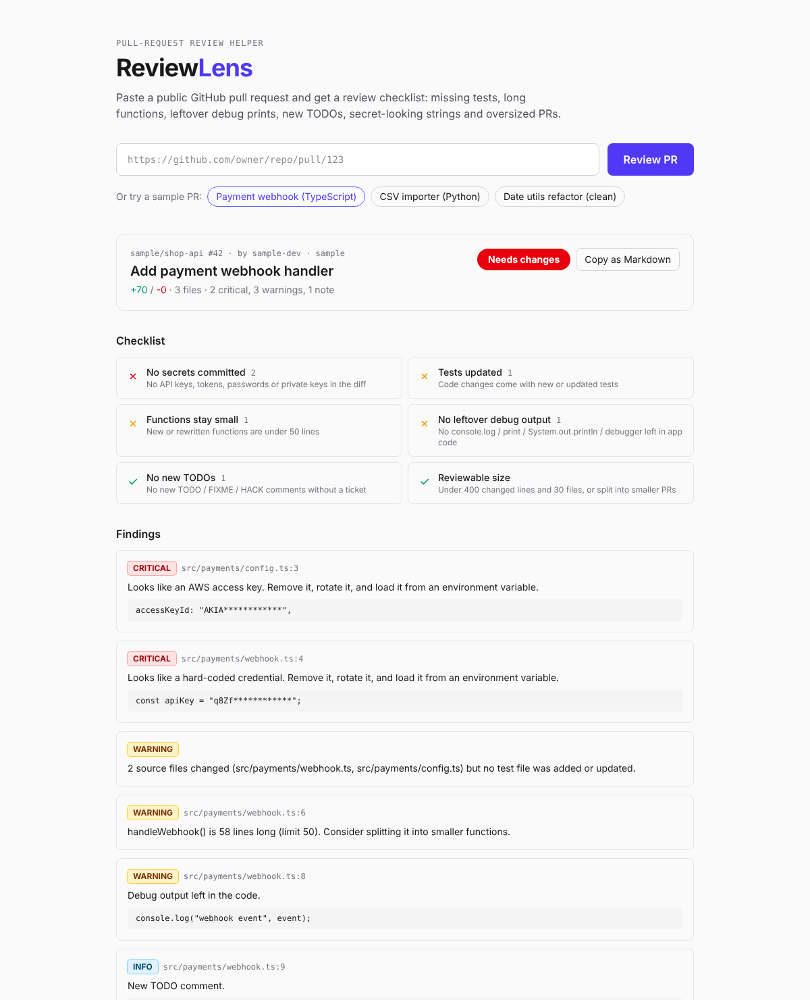

# ReviewLens

Paste a public GitHub pull request link and get a code-review checklist: missing tests, long functions, leftover debug prints, new TODOs, secret-looking strings and oversized PRs.

**Live demo:** https://reviewlens-mocha.vercel.app

[](https://github.com/Shreyashsalv2/reviewlens/actions/workflows/ci.yml)



## Features

- **Works with any public PR.** Paste `https://github.com/owner/repo/pull/123` (or `owner/repo#123`). The browser reads the PR from GitHub's REST API directly, so there is no server, account, token or API key.
- **Six checks**, shown as a checklist with a verdict (*Needs changes*, *Review carefully*, *Looks clean*):
  | Check | Flags | Severity |
  |---|---|---|
  | No secrets committed | AWS, GitHub, Stripe, Slack, Google and OpenAI-style keys, private keys, hard-coded passwords/tokens, committed `.env` files (values are masked in the report) | critical |
  | Tests updated | application code changed but no test file added or updated | warning |
  | Functions stay small | new or mostly rewritten functions over 50 lines (brace languages and Python) | warning |
  | No leftover debug output | `console.log`, `debugger`, `print`, `breakpoint()`, `System.out.println`, `fmt.Println`, `var_dump`… in app code (tests are allowed to print) | warning |
  | No new TODOs | new `TODO` / `FIXME` / `HACK` / `XXX` comments | note |
  | Reviewable size | over 400 changed lines or 30 files; files GitHub sent without a diff | warning / note |
- **Every finding links to the exact line** in the PR's head commit (forks included).
- **Copy as Markdown** turns the report into a checklist you can paste as a PR review comment.
- **Sample PRs** (made up, bundled with the app) show each verdict without using your GitHub quota.

## How it works

```
PR link ──parsePrUrl──▶ { owner, repo, number }
        ──fetchPullRequest (GitHub REST, paged)──▶ PR info + changed files with unified-diff patches
        ──parsePatch──▶ new-file lines with line numbers (added vs context)
        ──runRules (6 independent rules)──▶ findings, sorted critical → note
        ──buildReport──▶ checklist + verdict ──▶ UI  /  toMarkdown
```

- `lib/diff.ts` parses each file's unified diff into hunks of new-file lines, so every finding points at a real line number.
- `lib/rules/*` are small, pure functions with the same interface (`run({ pr, files }) → Finding[]`), so a new check is one file plus its tests.
- `lib/rules/longFunctions.ts` finds function starts in added code, then measures the body by brace depth (ignoring braces inside strings and comments) or, for Python, by indentation. If a hunk ends before the function does, it reports "at least N lines".
- `lib/github.ts` handles 404 (private or missing PR), GitHub's 60-requests-per-hour limit, network errors and pagination (up to 300 files).
- Everything runs client-side, so the deployed app is a static page.

## Stack

Next.js 16 (App Router) · React 19 · TypeScript · Tailwind CSS 4 · Vitest · GitHub Actions · Vercel

## Run it locally

```bash
npm install
npm run dev        # http://localhost:3000
```

## Tests and checks

```bash
npm test           # Vitest: diff parser, every rule, GitHub client (mocked fetch), report and Markdown
npm run lint
npm run typecheck
npm run build
```

CI runs all four on every push and pull request (`.github/workflows/ci.yml`).

## Limits

- Public repositories only, and GitHub allows 60 unauthenticated API requests per hour per network (one review uses 2 to 4).
- The checks are rules based on patterns, not a full parser: they catch common mistakes fast but cannot judge logic or design. A human still has to read the code.

## License

MIT
